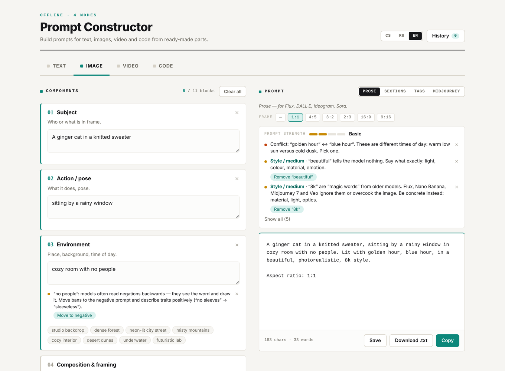

# Prompt Constructor

**Build better prompts for text, image, video and code models from ready-made parts — and get told what's missing.** You fill in labelled blocks (subject, lighting, camera, task, constraints…), pick an output format, and the tool assembles a clean prompt. As you type, a rule-based checker points out what would make the prompt stronger and offers one-click fixes.

> 🇨🇿 Skládej prompty pro text, obrázky, video a kód z hotových částí — s tipy, co prompt posílí.
> 🇷🇺 Собирай промпты для текста, изображений, видео и кода из готовых частей — с подсказками, что сделает промпт сильнее.

**[Open the constructor →](https://oz-the-magician.github.io/prompt-constructor/)**

## Modes and formats

| Mode | Blocks | Output formats |
|---|---|---|
| **Text** | role, context, task, output format, constraints, tone, audience, examples, notes | Markdown · XML tags · plain text |
| **Image** | subject, action, environment, composition, lighting, camera, style, palette, references, negative prompt, parameters + aspect ratio | prose (Flux, DALL·E, Nano Banana) · sections · tags (SDXL) · Midjourney |
| **Video** | subject, motion, environment, camera movement, composition, lighting, style, mood, pace, scene arc, parameters + aspect ratio | prose (Sora, Veo, Kling, Runway) · structured |
| **Code** | stack, task, existing code, contract, constraints, testing, response shape | prose · XML tags · spec |

Chips insert proven English terms (*golden hour*, *85mm*, *slow push-in*…), and hovering one shows a short definition with a diagram.

## Prompt hints

The checker runs entirely in the browser, without any AI model. It shows a **prompt strength** level (weak → strong) and hints both in a summary panel and under each block.

- **Vague judgements** like *beautiful*, *krásný*, *красиво* tell a model nothing, so the checker asks what exactly you mean.
- **“Magic words” from older models**, such as *masterpiece* and *8k*, are flagged. Modern models ignore them or overcook the image. They are allowed in the SDXL tags format.
- **Negations in the description**, like *no people*, get a one-click move to the negative prompt. Negations inside the negative prompt itself (*no text*) are flagged too.
- **Contradictions** are caught: golden hour vs blue hour, photorealistic vs anime, close-up vs wide shot, static camera vs push-in, slow motion vs time-lapse, and more. Russian and Czech synonyms are recognised.
- **Frame vs subject:** a portrait in a 16:9 frame or a landscape in 9:16 gets a one-click aspect fix.
- **Model specifics:**
  - Midjourney flags (`--v`, `--ar`) used in other formats are flagged, as is `--ar` set twice.
  - Lens terms in illustrations are pointed out as having little effect.
  - Text inside an image gets advice on placement and lettering.
  - Non-English text in Midjourney or SDXL formats triggers a warning.
- **Video:** too many actions or camera moves for one clip, and clips longer than models generate.
- **Text:** a generic role (*you are an expert*), prohibitions without a positive instruction, rules without a reason, CAPS and *MUST*, lengths without numbers, and a single example.
- **Code:**
  - a bug reported without the error message;
  - a fix requested without the code;
  - a task as broad as *make a website*;
  - a missing version in the stack;
  - *optimise* with no metric.
- **Everywhere:** API keys and passwords pasted by accident, unfilled template markers, duplicate blocks, and empty blocks that matter, with quick chips to fill them.

Each hint can be dismissed, and dismissed hints stay hidden.

## Everything else

- Interface in Czech, Russian and English. Prompts in Czech or Russian are assembled with labels instead of English connectors.
- History of saved prompts, plus copy and download as `.txt`.
- Draft and history are stored locally in the browser, and nothing is sent anywhere.

## Run locally

One self-contained file with no build step and no dependencies. Just open `index.html` in a browser.
